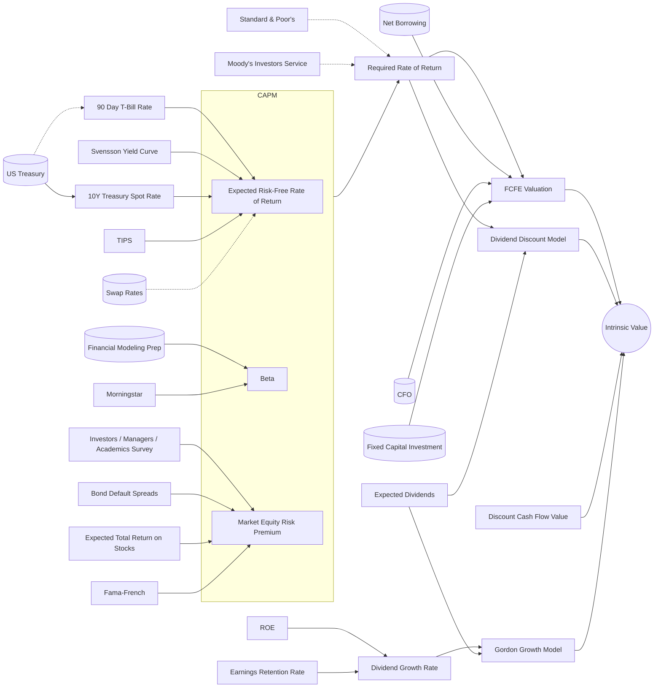

# Problem

To make better decisions, we must model their consequences and impacts.

#### Models

- Can be obscure (what's going on inside that black box?)
- Rely on various assumptions and inputs
- can often be radically decomposed
- Are limited in scope.

In every decision-making scenario, we end up leaving a lot of data on the table, because we don't know how, or don't have the tools, to integrate said data into our model.

## Insight

Models can always be expanded to include another parameter. And another.
But modelers then risk wandering outside their area of expertise.
One model's input is another model's output.
One model's assumption is another model's projection.

## Vision

Be the go-to tool for finding bias-free answers on a variety of questions, reducing arbitrary assumptions to bare minimum. The answer to any and every quantitative question forms/manifests thru the equation graph.
A repository for models: all the world's models in one place, linked to each other based on common variables
A set of tools for connecting models to each other
Criteria for classifying and evaluating models.
Automatic (?) sensitivity analyses, variance explanation, and uncertainty interpretation.
Wikipedia + GitHub + Kaggle + NutritionFacts + IFTTT + Bloomberg + Scratch-- for models

## Potential uses

- Prediction markets
- Climate change
- Price discovery / valuation, for anything
- stocks
- houses
- groceries
- Portfolio optimization
- Carbon footprint calculations, sea level rise
- DIMP risk models
- Water management
- Nutrition
- Pharmacology
- Decide when to impose/ease stay-home orders during pandemic
- Business, commerce
- General decision model
- VaR and other risk models
- And more...

## Potential users

Agents, and more generally LLMs (this will save turns, time, and tokens)
Government, regulators
University researchers
Research institutes
Scientists [e.g. climate scientists, ecologists]
Economists
Businesspeople
Investors, Traders
Pharma

## Challenges

How would this run? each model needs its own platform, many if not most might need external input [from databases and/or other models] as they start processing.
Proprietary model, code.
Specialty hardware [e.g. supercomputers]
How would this be a viable, sustainable business?
How do we get our first three paying clients? Who do we sell this to?
Where do we start?

## Some thoughts re Revenue models

Various predictions
subscriptions / premium
credit system, e.g. the more your model is used/accessed, the more points/credits/$ you gain
Charge per API call
Implement in financial markets and/or prediction markets for self / others
Exit

## Proprietary contributions (several separate projects I've worked on)

Beta distributions
Currency exchange models
[Distribution Integrity] Threat Interactions methodology

## Possible Components

#### Representations

1. constants
2. units
3. dimensions
4. equations
5. references
6. Algebraic, differential, integral operations
7. Computational graphs
   ...

## Example:  Intrinsic Value

---

### Example Model Structure

The supplied JSON represents a **DuPont Return on Investment (ROI) model**:

Profit Margin Graph

├─ EBIT = OI - OpEx + NOI

└─ PM = EBIT / OI

Asset Turnover Graph

├─ A_C = A_OC + Inv + AR + CE

├─ A = A_F + A_C

└─ Turnover = OI / A

ROI

└─ ROI = AT × PM

---

# Biggest questions

## Which direction to take this in

What I am missing? What am I not thinking of?

## How do I make this HUGE?

## What would different agents be doing [as they work in parallel]

## Sketch - in detail - a few of the potential paths this project might take
