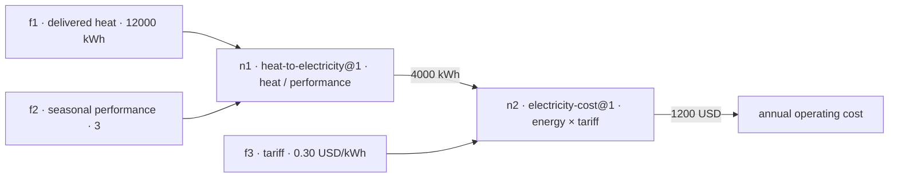

# Connected Models

Answers quantitative questions with grounded, testable results by composing reusable models and inspecting their inputs, assumptions, dependencies and results. The first runnable slice compares electric resistance heating with a heat pump, then connects operating savings to discounted investment value.

## Run the current prototype

Requires uv and Python 3.12 or newer. No third-party Python packages are required. Answering a question uses live inference and needs `META_API_KEY` in the environment (see Meta inference setup below); inspection, reports, tests and curation tools run offline.

```powershell
uv --cache-dir .uv-cache run --env-file .env -m connected_models answer 'Delivered heat is 12000 kWh. Heat pump seasonal performance is 3. Tariff is 0.30 USD/kWh. What is the annual operating cost?'
uv --cache-dir .uv-cache run --no-env-file -m connected_models inspect RUN_ID
uv --cache-dir .uv-cache run --no-env-file -m connected_models report RUN_ID
uv --cache-dir .uv-cache run --no-env-file -m connected_models usage
```

### Example

The question above parses into three typed facts (`12000` kWh delivered heat, `3` seasonal performance, `0.30` USD/kWh tariff, each with an exact quote from the question) and composes two eligible models:



It returns an annual operating cost of **1200 USD**. Every run saves its complete model definitions, input bindings, provenance and intermediate results under `.runs/`; earlier runs are preserved. `report` exports a self-contained HTML page with the question, facts, calculation steps, sources and reviews; opening it makes no API calls. These are illustrative inputs, not household measurements or purchasing advice.

The `answer` command accepts only a self-contained question: put assumptions, numbers, units and requested outputs in its text. It has no performance, tariff or investment options and uses only what the question states. The present-value model currently requires a positive discount rate and an integer horizon from 1 to 100 years. Performance must represent seasonal whole-system delivered heat divided by electricity use; a single temperature's COP rating is insufficient. Maintenance, cooling benefits, replacements, incentives, tariff escalation and uncertainty propagation are excluded from the initial heating models.

## Meta inference setup

The public settings in `inference.toml` select `muse-spark-1.3` in Standard mode and a $150 application-wide ceiling. The adapter uses the [Meta API route documented for coding agents](https://dev.meta.ai/docs/coding-agents).

The application accepts `META_API_KEY` from its process environment. Launch a bounded connection check with:

```powershell
uv --cache-dir .uv-cache run --env-file .env -m connected_models meta-smoke
```

This sends one bounded paid structured-output request. The command prints only connection status, model, request identifier and conservative cost. It never displays the key or raw API response. Offline tests use a fake transport and placeholder credential.

The persistent `.usage/meta.sqlite3` ledger reserves worst-case token cost before sending and settles against reported usage. Failed or ambiguous requests retain their reservation and are not retried automatically. Preserve this ledger across runs. Its ceiling covers calls through this application; spending in other tools or accounts is outside its accounting. Prices are pinned to the [Meta Standard-mode rates checked October 29, 2026](https://dev.meta.ai/docs/pricing-rate-limits); reverify pricing before changing models or rates. Use an account-side spending limit as well if the provider supports it.

## Test

```powershell
uv --cache-dir .uv-cache run --no-env-file -m unittest discover -s tests -v
```

Tests compare execution with a separately summed Decimal cash flow and NIST Handbook 135 (2020), equation 3-7, printed page 29 ($457.97 for five year-end payments of $100 discounted at 3%). They also exercise dimensional and semantic rejection, cycles, missing inputs, unsafe expressions, model substitution, saved-run preservation and persistent budget controls. All tests run without network calls.

## Implementation status

Implemented: bounded scalar algebra, explicit per-port context and meaning checks, ratio-unit conversions, graph compilation, deterministic evaluation, immutable run snapshots and a budgeted Meta adapter. Expressions are interpreted through an allowlisted AST; arbitrary Python code is not executed.

The registry workflow supports offline source extraction, candidate storage, attributed review/publication, withdrawal and query-time composition against eligible stored versions. 111 offline tests pass, including isolated curator packaging, compatible data returns and candidate-only import. Live question-only evaluation, inverse solving, discounted payback and missing-input clarification have been verified. The inspector prints saved evidence and can export a standalone HTML report, including inputs quoted from the question. The contracts implement a bounded subset of the representation draft, not full v0 conformance.

## How models are represented

All representation contracts live in `connected_models/contracts.py` as frozen dataclasses:

- A **Model** is one revisioned scalar relationship: an id, a version, named input **Ports**, one output Port, an expression string, guard strings, a source, and assumption strings. Revisions are immutable; the `id@version` key is the only way to reference one.
- A **Port** is a meaning, a ratio unit, and an exact context string (for example `delivered_heat` in `kWh` for `home-A:representative-year:constant-real-prices`). Binding requires an exact meaning/context match; units convert only through the registry scales, and currency units never convert implicitly.
- **Dimensions** are exact seven-axis rational vectors: mass, length, time, currency, temperature, current, amount. The `UNITS` table maps each unit string to dimensions plus a scale against the canonical basis (kWh, m, s, USD, K, A, mol); the `MEANINGS` table maps each meaning to its dimensions, so a port's meaning and unit are checked against each other.
- **Expressions** use scalar arithmetic (`+ - * / **`), comparisons in guards, and the allowlisted calls `log`, `log10`, `exp`, `sqrt`, `sum`, `prod`, `len`. Powers carry bounded exact-rational exponents; expressions are capped at 2048 characters and 128 AST nodes. Anything else is rejected before evaluation.
- There is no engine constants table: curated constants are transcribed as exact numeric literals in canonical units, and physical constants that carry units ride input variables with registry units instead (see the canonical-expressions decision in Project Memory).
- A **Composition** is a bounded scenario: nodes plus requested outputs. Each **Node** instantiates one model revision, binding every input to a **Value** (an amount with a port, an origin, and evidence) or a **Reference** to an upstream node. Index-family inputs take bounded tuples (at most 256 elements) for summation-style models.

## How models execute

Execution (`connected_models/runtime.py`) is deterministic and has no inference inside it:

1. **Compile** the composition: topologically sort nodes, reject cycles, and check every binding against its model's ports (meaning/context match, guard domains, scenario input origins).
2. **Normalize** each input to canonical units by multiplying with its unit scale.
3. **Check guards** against the normalized inputs, then **evaluate** the expression (or run the bounded solver for a `solve_for` view).
4. **Denormalize** the result into the output port unit and record the step: normalized inputs, result, evidence, and everything it relied on.

The run manifest pins the exact model definitions (with a snapshot hash), the vocabulary, and the admissions in force, so `replay RUN_ID` can re-execute later and report whether status, error and outputs match exactly. `revise` never modifies a saved run; it writes a new run linked with `revised_from`.

## How the LLM is used

`answer` makes one structured-output call (`AnswerQuestionGrounded`) and nothing else. The call parses the question into typed facts with exact quotes and then composes a graph from those facts in the same response, planning backward from the requested output: find models producing it, check assumptions, and recursively satisfy each input from a fact or an upstream model. The model cannot emit numeric literals; the runtime validates every fact (exact quote in the question, unique IDs), validates the graph shape, checks every binding, and executes it. Contradictory questions and missing inputs yield `needs-input` with clarification questions; a clarification may propose a specific assumed value with justification for the user to confirm or replace, but estimates never fill graph bindings silently. Unsupported coverage yields `blocked`.

The system prompt lives as an editable file, `prompts/answer-question.md`, and loads on every request; see `prompts/README.md` for the editing rules. The JSON schema and the user message (question, solver profile, model catalog) stay in code in `connected_models/workflows.py`. Each catalog entry carries only composition signal — input/output ports, assumptions, and guards when non-empty; identity, version, status, source, and expression stay in the database. A second prompt, `prompts/offline-model-extraction.md`, serves the `curate` command, which extracts one NIST source relationship into an unapproved candidate. Every call accrues through the spend ledger described above. The call currently receives the full eligible catalog; catalog retrieval is future work.

## Curate, review and reuse models

For multiple offline research agents, use the [owner/operator guide](knowledge/notes/offline-curation-agent-kit.md). Each isolated worker kit contains the complete [curator protocol](knowledge/notes/offline-curator-instructions.md) as `AGENTS.md`, exact schema/example and offline validation tools. It contains no owner guidance and at most one assignment. Curators build atomic reusable models; chains and sample queries are optional. Give a generic-kit worker `Read @AGENTS.md and work on {assignment JSON}`, or use a domain kit and `Read @AGENTS.md and work on @assignment.json`. Subsequent assignments select new batch folders/IDs and preserve earlier returns automatically. Candidates with new physical units retain integration blockers; curators do not publish models or merge databases.

```powershell
# Build a portable snapshot; the output must not already exist.
uv --cache-dir .uv-cache run --no-env-file -m connected_models.curation kit curation-generic-2026-10-31.5.zip
# Or include only the chosen worker's assignment:
uv --cache-dir .uv-cache run --no-env-file -m connected_models.curation kit curation-building-energy-2026-10-31.5.zip --domain building-energy
# Check and stage a returned batch on the integration PC; this does not publish.
uv --cache-dir .uv-cache run --no-env-file -m connected_models.curation validate incoming/building-energy-a01-b01-return.zip
uv --cache-dir .uv-cache run --no-env-file -m connected_models.curation import incoming/building-energy-a01-b01-return.zip
```

The kit pins its own version and JSON schema. It carries no credentials, inference adapter/configuration, local databases or third-party dependencies. The validator checks scalar arithmetic and optional current-runtime projections; scientific source review and physical-dimensional validation of new-domain research remain explicit integration work. See the guide for source restrictions, version conflicts, repeat imports, review commands and the optional Git workflow for agents assigned code integration.

Generate a dated catalog snapshot before dispatch to reduce duplicates and catch conflicting immutable IDs before import:

```powershell
uv --cache-dir .uv-cache run --no-env-file -m connected_models.curation inventory from-offline-curation-workers fleet-inventory.json
uv --cache-dir .uv-cache run --no-env-file -m connected_models.curation kit building-energy-worker.zip --domain building-energy --inventory fleet-inventory.json
```

Create a separate reviewer packet, then validate the returned report and stage a supported recommended record:

```powershell
uv --cache-dir .uv-cache run --no-env-file -m connected_models.auditing packet incoming/return.zip reviewer-packet.zip
uv --cache-dir .uv-cache run --no-env-file -m connected_models.auditing validate incoming/return.zip incoming/review.json
uv --cache-dir .uv-cache run --no-env-file -m connected_models.integration incoming/return.zip incoming/review.json MODEL_ID --version r1.runtime1
```

Give only the extracted packet to a different reviewer agent with `Read @AGENTS.md and complete @assignment.json`. See the [operator guide](knowledge/notes/offline-curation-agent-kit.md#separate-auditor-handoff-and-technical-integration) for review criteria, projection evidence and the separate attributed admission command. Neither report validation nor projection publishes a model. To reproduce the committed example without the original ZIP, the validator and integrator also accept `data/curation/reviews/classical-mechanics-a-b01-bundle.json` with its corresponding review JSON.

The application credential variable is **META_API_KEY**. This overrides the variable name shown in Meta's generic documentation. The following commands stage project-derived candidates, run a paid extraction from the bundled NIST source packet, and report on a bundle:

```powershell
# Stage four supporting project-derived candidates, without publishing them.
uv --cache-dir .uv-cache run --no-env-file -m connected_models seed-candidates
# Make a paid offline extraction from the bundled public NIST source packet.
uv --cache-dir .uv-cache run --env-file .env -m connected_models curate
# Produce a readable report of sources, extracted algebra, assumptions and checks.
uv --cache-dir .uv-cache run --no-env-file -m connected_models review-bundle
```

The curator receives the NIST equation with its source notation and a canonical interface, then extracts executable algebra and a symbol/source map. It does not receive the fixture's program expression. The published numerical example is checked independently before review. Incomplete or failing extractions remain candidates with diagnostics. Supporting accounting definitions are explicitly marked manual project derivations; they are not misrepresented as agent extractions.

Inspect a candidate with `candidate CANDIDATE_ID`. After checking source fidelity, applicability, interface meanings and assumptions, the owner records a scoped review:

```powershell
uv --cache-dir .uv-cache run --no-env-file -m connected_models review CANDIDATE_ID --decision accepted --reviewer owner --notes 'Describe the checked source and permitted scenario use'
uv --cache-dir .uv-cache run --no-env-file -m connected_models registry-list
```

Each model revision is immutable. A replacement definition needs a new version. A `withdrawn` review prevents new snapshots from using that candidate; saved runs keep their original evidence. Eligibility is snapshotted at the start of a short local run rather than revoked mid-calculation. This is a single-operator trust boundary: explicit local review commands carry publication authority, and the reviewer identity/scope are retained. The curator/composer inference roles have no publication tools and cannot approve their own outputs. Broader scientific approval policy remains unresolved.

Once all necessary versions are eligible, ask a self-contained question. For example:

```powershell
$question = @'
Annual delivered heat demand is 12000 kWh. Baseline resistance heating has seasonal performance 1 and the proposed heat pump has seasonal performance 3. Electricity has a flat tariff of 0.30 USD/kWh. The incremental upfront investment is 10000 USD. Use an annual effective real discount rate of 5 percent and a study horizon of 10 years. Assume the same delivered heat and comfort, constant real prices and annual savings paid at each year end, with no maintenance differences, replacements, cooling benefits or residual value. Calculate annual operating costs, annual savings and the investment net present value.
'@
uv --cache-dir .uv-cache run --env-file .env -m connected_models answer $question
uv --cache-dir .uv-cache run --env-file .env -m connected_models answer 'For the same annual delivered heat of 12000 kWh, compare baseline electric heating with seasonal performance 1 and a heat pump with seasonal performance 2.5, using a flat tariff of 0.25 USD/kWh in constant real prices. Exclude cooling benefits, maintenance differences, and changes in fixed charges. Calculate annual operating costs and savings only.'
uv --cache-dir .uv-cache run --no-env-file -m connected_models inspect RUN_ID
uv --cache-dir .uv-cache run --no-env-file -m connected_models report RUN_ID ANOTHER_RUN_ID
uv --cache-dir .uv-cache run --no-env-file -m connected_models usage
```

The first query-time step extracts a domain-independent list of typed facts (number, date or text), with exact quotes from the question. Numeric literals and supported adjacent units are checked against those quotes. The composer receives these facts and eligible stored definitions; each external input must reference a fact ID, and each derived input must reference an upstream node. It cannot emit a new numeric literal or use a remembered preset value. A structured graph object avoids nested JSON-string generation. The compiler checks and executes the resolved graph, saving both extraction evidence and proposed assignments to model inputs.

If the question omits required inputs, the result is `needs-input` with specific clarification questions and no calculated answer. Asking only for annual operating costs does not require an investment amount, horizon or discount rate. Unsupported model coverage remains `blocked`, with parsed inputs retained. This currently uses a self-contained follow-up question rather than persistent conversational state. Generated estimates remain disabled until a scoped consent flow exists; source curation never runs inline.

The parser is not tied to heating names: it can retain a number of apples, a birth date, or a person's name. Executing date/text operations or a new domain still requires suitable stored models and runtime support; the current engine is scalar numeric and the catalog holds 109 eligible models across heating, finance, economics, biology, computer science, mechanics, building energy and circuits. Executable numbers currently require explicit digit literals (commas and decimal/exponent forms are supported). Percentages remain in percent until the unit layer converts them. Exact quotes and numeric checks do not prove perfect semantic interpretation; the report exposes the selected fact-to-port assignments for inspection.

## Revise a saved run and compare results

Any saved run with an executable graph can be revised without inference: change direct inputs, substitute a model revision on a node, or both. The original run file is never modified; the revision is saved as a new run linked with `revised_from`. Scenario (`answer`) runs re-execute against the registry's current eligible snapshot, so `--model` selects among reviewed revisions. Amounts use the model's declared port unit, shown by `inspect`.

```powershell
uv --cache-dir .uv-cache run --no-env-file -m connected_models revise RUN_ID --set upgrade-energy.performance=2 --set investment-npv.investment=12000
uv --cache-dir .uv-cache run --no-env-file -m connected_models revise RUN_ID --model upgrade-energy=heat-to-electricity@2
uv --cache-dir .uv-cache run --no-env-file -m connected_models report RUN_ID REVISED_RUN_ID
```

Only direct value inputs can be revised; calculated upstream bindings are rejected with an explanation, as are unknown nodes, undeclared inputs and unavailable model revisions (the error lists what is available). A revision that violates model guards or interface checks is saved as a rejected run with diagnostics, preserving the failure evidence. Listing two or more runs in `report` adds a "What changed" comparison of outputs with deltas, changed inputs and changed models, each run compared against the first listed.

To verify deterministic reproduction without creating a new run, `replay RUN_ID` re-executes the saved graph against its pinned models and admissions and reports whether status, error and outputs match exactly. It saves nothing and exits nonzero on any mismatch.

## Solve for another quantity in an existing relationship

Directional solve views answer rearranged questions without separate scientific models for every rearrangement. A model revision retains its equation, source, interface meanings, guards and review. A run may select a declared input as `solve_for`, supply all other inputs and the known original output through the reserved `__output__` binding, and return the selected variable using its original unit/context. The composer creates these views through the same question-only interface. It never generates or executes a new formula as an agent-authored model.

```powershell
uv --cache-dir .uv-cache run --env-file .env -m connected_models answer 'A heating system supplies 12000 kWh of delivered heat over a representative year and consumes 4000 kWh of electricity over that same year, with auxiliaries and losses included. What effective seasonal performance does this imply?'
uv --cache-dir .uv-cache run --env-file .env -m connected_models answer 'My annual electricity operating cost is 1200 USD with a flat tariff of 0.30 USD/kWh in constant real prices. Fixed charges are unchanged, and maintenance and cooling benefits are excluded. What annual electricity consumption corresponds to that cost?'
uv --cache-dir .uv-cache run --env-file .env -m connected_models answer 'I am considering replacing my resistance heating with a $10000 heat pump. When would this pay off, assuming a 5% real discount rate? Annual delivered heat demand is 12000 kWh. Baseline resistance heating has seasonal performance 1 and the proposed heat pump has seasonal performance 3. Electricity has a flat tariff of 0.30 USD/kWh'
```

Payback applies the original present-value model's constant-real, uniform year-end savings assumptions conditionally; it does not infer actual equipment life or different maintenance/replacement costs. Its 1–100 year search domain comes from the model guards, not an invented user horizon.

The first algebra profile substitutes known canonical-unit values into restricted rational arithmetic, forms an exact rational-coefficient polynomial, and solves degree one or two over real numbers. Unknown-dependent powers are restricted to integer magnitude at most two; intermediate degree and coefficient-size limits are explicit. Candidates are re-evaluated in the unmodified original expression with every source guard and type constraint; denominator exclusions survive rearrangement. Residual tolerances are recorded (1e-9 relative and absolute). Multiple admissible roots remain an explicit ambiguity with candidates, not a guessed positive branch. Unsupported forms, numerical limits, undefined domains, underdetermination and no admissible root are distinguished. Fixed literals are not free variables. The unitless E=m*c² fixture tests algebra only; this does not add a curated physics model or SI mass/speed vocabulary.

For integer period-count targets, a non-polynomial equality can use finite enumeration when original guards supply both bounds. A requested earliest threshold uses `relation=at_least`, checks each admissible integer in ascending order, and returns the first crossing without assuming monotonicity. At most 1,000 candidate integers are evaluated. Failure means no crossing within that declared domain, not no possible crossing anywhere. Fractional-time payback, general continuous root finding, systems of unknowns, higher-degree/transcendental symbolic solving and user-selected branches outside model guards remain unsupported. Algebraic reversal does not establish causal reversal or a scientifically valid inverse of a statistical/calibrated model.

Curators remain responsible for source relationships, scientific scope, variable roles/constants and domain constraints. The solver is a separate deterministic facility. Future derived implementations can be cached/indexed against a pinned source revision and solver profile without multiplying canonical model identities. Independently estimated inverse models or changed scientific assumptions would need their own linked evidence/review.

Local runtime artifacts are stored in `.registry/`, `.runs/` and `.usage/`, all excluded from version control. Preserve the registry and spend ledger when continuing the prototype.

The canonical delivery plan is [MVP milestones](knowledge/notes/mvp-build-sequence-and-extension-triggers.md); current project context is in [PROJECT_STATE.md](PROJECT_STATE.md). Source/evidence records and design decisions live in Project Memory under `knowledge/`.
