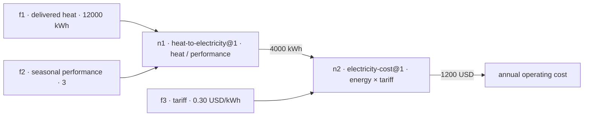

# Connected Models

Ask a quantitative question, get a calculated answer — not a generated paragraph. Connected Models (CADRE) composes reusable, reviewed quantitative models into an executable pipeline, runs it deterministically, and shows every receipt: inputs quoted from your question, assumptions, model sources, and intermediate results. When the evidence isn't there, it says so instead of inventing numbers.

580+ reviewed models across 14 domains (finance, economics, energy, mechanics, biology, clinical arithmetic, computer science and more), 263 offline tests, zero third-party runtime packages.

## Why

- **Computed, not generated.** A bare LLM does arithmetic in prose where no one can check it. CADRE executes reviewed expressions exactly, with units and guardrails, so the number is reproducible bit-for-bit (`replay` proves it).
- **Refuses instead of inventing.** Ask for a Kelly bet without a win probability and the grounded route stops with `needs-input`, naming the missing number — while the direct LLM invents `p = 0.50` and recommends staking 25% of your bankroll. `compare` scores that `agreement: guarded`.
- **Answers half-questions honestly.** When one pipeline link has no reviewed model, an opt-in flag lets bounded in-context calculation fill the gap; the run is labelled `partial` and every other link keeps full provenance.

## Quickstart

Requires uv and Python 3.12 or newer. Live questions need `META_API_KEY` in the environment; everything else runs offline. Full setup, inference configuration and static gates: [docs/setup.md](docs/setup.md).

```powershell
uv sync
uv run connected-models answer 'Delivered heat is 12000 kWh. Heat pump seasonal performance is 3. Tariff is 0.30 USD/kWh. What is the annual operating cost?'
uv run --no-env-file connected-models inspect RUN_ID
uv run --no-env-file connected-models report RUN_ID
uv run connected-models compare 'YOUR QUESTION'
uv run --no-env-file connected-models usage
```

The `answer` command accepts only a self-contained question: put assumptions, numbers, units and requested outputs in its text.

## Example

The heat-pump question parses into typed facts (each with an exact quote from the question) and composes two eligible models:



It returns **1200 USD**. Every run saves its complete model definitions, input bindings, provenance and intermediate results under `.runs/`; earlier runs are preserved. `report` exports a self-contained HTML page with the question, facts, calculation steps, sources and reviews; opening it makes no API calls. These are illustrative inputs, not household measurements or purchasing advice.

**Who benefits:** this running example is Dana's story — a homeowner weighing a quoted 10000 USD heat-pump retrofit. The full impact scenario (named beneficiary, inputs, model connections, execution, results, and the pessimistic revision that flips the decision) is in [Impact](docs/impact.md): annual saving 2400 USD, 10-year NPV 8532.16 USD at 5% real.

## Interfaces

Four ways in, same engine underneath:

- **CLI** — `answer`, `compare`, `inspect`, `report`, `revise`, `replay`, `scenarios`, `curate`, `review`. Scriptable, pipe-friendly, fully offline except inference calls.
- **Web UI** — `connected-models serve --port 8000`, then open http://127.0.0.1:8000/ in a browser: ask questions, watch the model graph animate, revise scenarios with sliders, and browse every reviewed model with auto-generated input-to-output diagrams. One bundled file, standard library only, no external requests. Guide: [docs/demo.md](docs/demo.md).
- **Agent skill** — Muse sessions invoke `/connected-models` to answer quantitative questions through composed reviewed models instead of prose arithmetic.
- **MCP server** — any MCP client registers `connected-models mcp` as a stdio server and calls the same tools agents use. Details: [docs/mcp.md](docs/mcp.md).

Seeded offline fixtures for trying the UI without credentials: `connected-models demo-seed`.

## Model registry

Models live in a local SQLite database (`.registry/models.sqlite3`, excluded from version control) in three tables:

- `candidates` — staged research projections awaiting a decision; nothing executes from here.
- `models` — admitted revisions keyed `domain--name@revision`, the only rows the composer can use.
- `reviews` — attributed accept/reject/withdraw decisions with notes; publishing happens only through an explicit review operation.

Curator agents do the heavy reading offline: they extract candidate models from source packets (see `from-offline-curation-workers/`), verify references and guard behaviour, and file review bundles under `data/curation/reviews/`. Owners admit them with `connected-models review ID --decision accepted`, and can reverse with `withdrawn`. The flow — extract, stage, review, publish, withdraw — is documented in [Curation](docs/curation.md). A temporary rights waiver for licence-blocked records is off by default (details there).

Expressions are interpreted through an allowlisted AST; arbitrary Python code is never executed. Units and meaning/context compatibility are checked at every binding, and dimension, guard, reference and revision gates refuse silently unsafe compositions.

## Test

```powershell
uv run pytest -q
```

263 offline tests, no network calls. Details and the static gates (ruff, mypy strict): [docs/setup.md](docs/setup.md#test).

## Implementation status

Implemented: bounded scalar algebra, explicit per-port context and meaning checks, ratio-unit conversions, graph compilation, deterministic evaluation, immutable run snapshots, a budgeted Meta adapter, partially grounded answers behind `CADRE_ALLOW_LLM_STEPS`, guarded compare verdicts, live question-only evaluation, inverse solving, discounted payback, missing-input clarification, what-if scenarios and model substitution. Maintenance, cooling benefits, replacements, incentives, tariff escalation and uncertainty propagation are excluded from the initial heating models. The contracts implement a bounded subset of the representation draft, not full v0 conformance.

## Project layout

```text
src/connected_models/         installed package: contracts, runtime, workflows, CLI
src/connected_models/prompts/ editable LLM system prompts (package data)
src/connected_models/web/     single-file web demo page (package data)
.agents/skills/               Muse skills (repo-level, including connected-models)
src/connected_models/data/    bundled NIST source packet (package data)
tests/                        offline suite, pytest + unittest compatible
evals/                        live batteries (need credentials)
docs/                         setup, architecture, curation, runs, prompts
data/                         curation assignments/reviews/inventories, eval batteries
knowledge/                    Project Memory: decisions, findings, operator guides
from-offline-curation-workers/ preserved worker returns (see ABOUT.md there)
```

## Docs

- [Impact](docs/impact.md) — who benefits, problem-statement fit, worked scenario
- [Demo script](docs/demo-script.md) — live runbook: commands, expected outputs, fallbacks
- [Demo guide](docs/demo.md) — web UI, SKILL, video recording
- [MCP server](docs/mcp.md) — agent tools over stdio
- [Setup and running](docs/setup.md) — install, inference config, tests, gates
- [Architecture](docs/architecture.md) — representation, execution, LLM use
- [Curation](docs/curation.md) — curate, review and reuse models
- [Runs](docs/runs.md) — revise, replay, solve and partially grounded answers
- [Prompts](docs/prompts.md) — editing the system prompts
- [Eval batteries](data/eval/README.md) — live composer benchmarks

## License

MIT, see [LICENSE](LICENSE).
