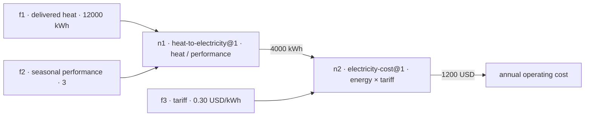

# Connected Models

Answers quantitative questions with grounded, testable results by composing reusable models and inspecting their inputs, assumptions, dependencies and results. The first runnable slice compares electric resistance heating with a heat pump, then connects operating savings to discounted investment value.

## Run

Requires uv and Python 3.12 or newer. No third-party runtime packages are required. Live questions need `META_API_KEY` in the environment; everything else runs offline. Full setup, inference configuration and static gates: [docs/setup.md](docs/setup.md).

```powershell
uv sync
uv run --env-file .env connected-models answer 'Delivered heat is 12000 kWh. Heat pump seasonal performance is 3. Tariff is 0.30 USD/kWh. What is the annual operating cost?'
uv run --no-env-file connected-models inspect RUN_ID
uv run --no-env-file connected-models report RUN_ID
uv run --no-env-file connected-models usage
```

### Example

The question above parses into three typed facts (`12000` kWh delivered heat, `3` seasonal performance, `0.30` USD/kWh tariff, each with an exact quote from the question) and composes two eligible models:



It returns an annual operating cost of **1200 USD**. Every run saves its complete model definitions, input bindings, provenance and intermediate results under `.runs/`; earlier runs are preserved. `report` exports a self-contained HTML page with the question, facts, calculation steps, sources and reviews; opening it makes no API calls. These are illustrative inputs, not household measurements or purchasing advice.

The `answer` command accepts only a self-contained question: put assumptions, numbers, units and requested outputs in its text. It has no performance, tariff or investment options and uses only what the question states. The present-value model currently requires a positive discount rate and an integer horizon from 1 to 100 years. Performance must represent seasonal whole-system delivered heat divided by electricity use; a single temperature's COP rating is insufficient. Maintenance, cooling benefits, replacements, incentives, tariff escalation and uncertainty propagation are excluded from the initial heating models.

### Demo

```powershell
uv run --no-env-file connected-models demo-seed
uv run --env-file .env connected-models serve --port 8000
```

Then open http://127.0.0.1:8000/ in a browser: ask questions, watch the model graph animate, and revise scenarios with sliders. The page is one bundled file served from the standard library — no third-party packages, no external requests. Muse sessions can also invoke the repo skill with `/connected-models`, and any MCP client can register `connected-models mcp` as a stdio server. Guide and 3-minute video plan: [docs/demo.md](docs/demo.md), [docs/demo-video.md](docs/demo-video.md), [docs/mcp.md](docs/mcp.md).

## Test

```powershell
uv run pytest -q
```

183 offline tests, no network calls. Details and the static gates (ruff, mypy strict): [docs/setup.md](docs/setup.md#test).

## Implementation status

Implemented: bounded scalar algebra, explicit per-port context and meaning checks, ratio-unit conversions, graph compilation, deterministic evaluation, immutable run snapshots and a budgeted Meta adapter. Expressions are interpreted through an allowlisted AST; arbitrary Python code is not executed.

The registry workflow supports offline source extraction, candidate storage, attributed review/publication, withdrawal and query-time composition against eligible stored versions. Live question-only evaluation, inverse solving, discounted payback and missing-input clarification have been verified. The inspector prints saved evidence and can export a standalone HTML report, including inputs quoted from the question. The contracts implement a bounded subset of the representation draft, not full v0 conformance.

## Project layout

```text
src/connected_models/         installed package: contracts, runtime, workflows, CLI
src/connected_models/prompts/ editable LLM system prompts (package data)
src/connected_models/web/     single-file web demo page (package data)
.agents/skills/               Muse skills (repo-level, including connected-models)
src/connected_models/data/    bundled NIST source packet (package data)
tests/                        offline suite, pytest + unittest compatible
evals/                        live batteries (need credentials)
docs/                         setup, architecture, curation, runs, prompts
data/                         curation assignments/reviews/inventories, eval batteries
knowledge/                    Project Memory: decisions, findings, operator guides
from-offline-curation-workers/ preserved worker returns (see ABOUT.md there)
```

## Docs

- [Demo guide](docs/demo.md) — web UI, SKILL, video recording
- [Demo video plan](docs/demo-video.md) — 3-minute shot list
- [MCP server](docs/mcp.md) — agent tools over stdio
- [Setup and running](docs/setup.md) — install, inference config, tests, gates
- [Architecture](docs/architecture.md) — representation, execution, LLM use
- [Curation](docs/curation.md) — curate, review and reuse models
- [Runs](docs/runs.md) — revise, replay and solve views
- [Prompts](docs/prompts.md) — editing the system prompts
- [Eval batteries](data/eval/README.md) — live composer benchmarks

## License

MIT, see [LICENSE](LICENSE).
