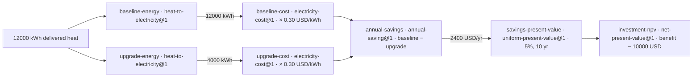

# Impact: who benefits and why it matters

Primary problem-statement fit: **Build for Your World**. Connected Models brings Meta's models into a domain the asker knows firsthand — a household energy decision — and makes rigorous comparison possible where before there was either guesswork or blind trust in prose arithmetic. It frees time and mental space by composing reviewed models deterministically and showing every receipt. Secondary fit to **Push the Frontier**: the same run demonstrates a new machine capability — inspectable composition of energy and finance models over a physical system — rather than a basic chat integration.

## The beneficiary: Dana's heat-pump quote

Dana heats her home with working electric resistance heating. An installer quotes a **10000 USD** heat-pump retrofit and claims it "pays for itself". She knows her approximate annual delivered heat (**12000 kWh**), the quoted seasonal whole-system performance (**3**), her flat tariff (**0.30 USD/kWh**), and her planning assumptions (**5%** real discount rate, **10** years). She wants one honest answer: what does this cost to run, and is the investment worth it?

This is the bounded end-to-end workflow a judge can inspect: her inputs, five reviewed model connections, deterministic execution, and results with provenance.

## Inputs (Dana's numbers, quoted exactly)

| Fact | Amount | Unit | Source |
| --- | --- | --- | --- |
| Annual delivered heat | 12000 | kWh | her usage estimate |
| Baseline seasonal performance | 1 | 1 | resistance reference |
| Heat-pump seasonal performance | 3 | 1 | installer quote |
| Flat real tariff | 0.30 | USD/kWh | her bill |
| Incremental install cost | 10000 | USD | installer quote |
| Real discount rate / horizon | 0.05 / 10 | 1 | her planning choice |

`answer` keeps the exact quote behind every parsed fact; nothing is silently invented.

## Model connections (one output feeds the next input)



Five explicitly labeled demo fixtures; each carries its expression, source, assumptions, and `demo-seed` review. No step does math in prose.

## Execution (deterministic, offline-capable)

```powershell
uv run --no-env-file connected-models demo-seed
uv run --no-env-file connected-models replay RUN_ID
```

`demo-seed` admits the five fixtures idempotently and saves both scripted runs with zero inference spend. `replay` re-executes a saved run against its pinned models and reports `"matched": true`. Live questions go through the same engine via `answer`; `revise` re-runs scenarios without touching the original.

## Results (Dana's receipt)

| Output | Amount | Meaning |
| --- | --- | --- |
| Baseline operating cost | 3600 USD/yr | resistance heating at 0.30 USD/kWh |
| Heat-pump operating cost | 1200 USD/yr | one third of the electricity |
| Annual saving | 2400 USD/yr | baseline minus upgrade |
| 10-year net present value | 8532.16 USD | discounted savings minus 10000 USD |

The base case supports the retrofit — but the inspection is the point. A pessimistic but plausible revision (performance **2**, tariff **0.25 USD/kWh**, install **12000 USD**) flips the NPV to **-417.40 USD**:

```powershell
uv run --no-env-file connected-models revise RUN_ID --set upgrade-energy.performance=2 --set baseline-cost.tariff=0.25 --set upgrade-cost.tariff=0.25 --set investment-npv.investment=12000
```

Same models, same evidence, new scenario; the original run is preserved and the delta table shows exactly what changed. That sensitivity check is why a receipt beats a confident paragraph.

## Why it matters beyond Dana

- **Who benefits:** homeowners and small landlords facing retrofit quotes, volunteer energy advisors, and any AI agent that must answer quantitative questions without hallucinating arithmetic.
- **How much it matters:** a single wrong retrofit decision costs five figures; the method generalizes to every "one model's output is another model's input" chain (energy → cost → savings → investment value here; 180+ curated models already in the registry for other chains).
- **Could people actually use it:** yes — `demo-seed` + `serve` runs locally with zero runtime dependencies, the web page animates the graph and revisions, and `report` exports a self-contained evidence page with no API calls. See [demo.md](demo.md).

## Honest limits

These are illustrative synthetic fixtures, not household measurements or purchasing advice. The heating models assume the same delivered heat and comfort, a flat real tariff with unchanged fixed charges, and exclude maintenance, cooling benefits, replacements, incentives, tariff escalation, and uncertainty propagation. Performance must be seasonal whole-system delivered heat over electricity use; a single-temperature COP rating is insufficient.
