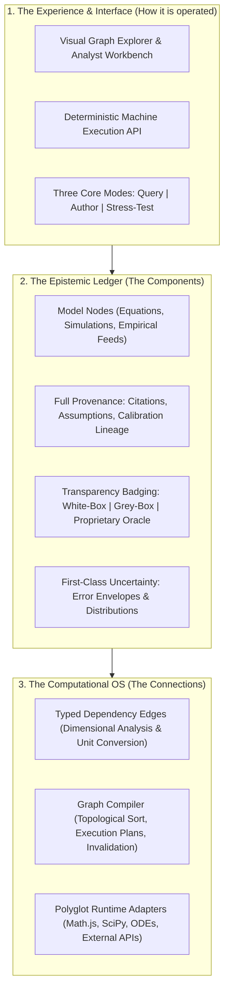
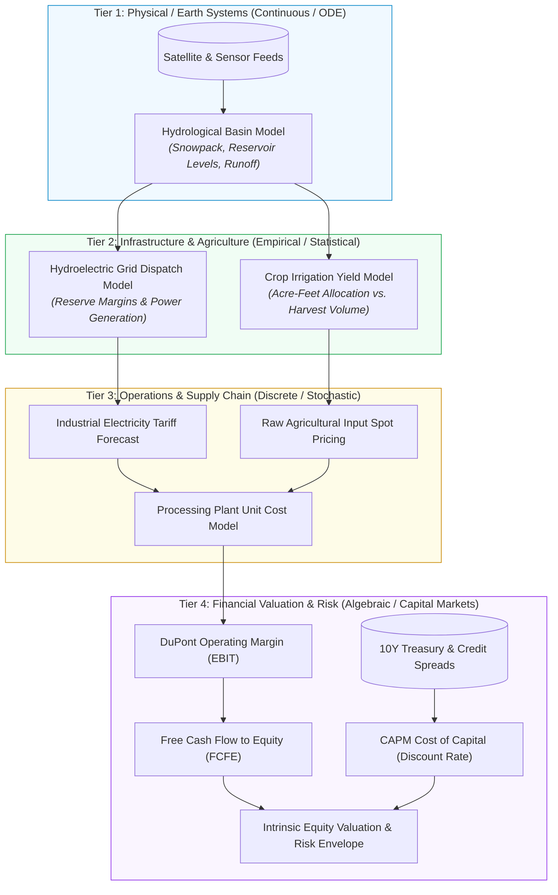

# Vision for the End-State Deliverable

## Current understanding

In its mature end state, Connected Models is a **universal computational medium**—an open, executable fabric for quantitative knowledge analogous to what the World Wide Web is for hypertext or what Git is for source code. It is an infrastructure designed to be consumed and operated with equal fluidity by human researchers and autonomous AI agents.

The architecture synthesizes three complementary dimensions into a unified whole:

### 1. The Epistemic Ledger (Components)
Every quantitative model in the world exists as a first-class **Model Node**:
- **Explicit Boundary Contracts**: Nodes formally declare required input variables, assumptions, parameters, and generated outputs.
- **Transparency & Badging Spectrum**: Rather than categorically excluding closed-source code, nodes declare their transparency tier:
  - *White-Box (Open/Verifiable)*: Fully inspectable source code, closed-form equations, and reproducible calculations.
  - *Grey-Box (Semi-Open)*: Known mathematical structure with calibrated or proprietary parameter weights.
  - *Black-Box (Proprietary / Oracle)*: Hosted external services or proprietary binaries. While internals are opaque, the node must conform to strict interface contracts, dimensional typing, and declared error bounds. Consumers retain sovereign policy control over whether proprietary nodes are permitted in their execution paths.
- **Uncertainty as First-Class Data**: Outputs are not restricted to scalar point estimates; nodes can emit confidence intervals, probability distributions, and parameter sensitivity derivatives ($\frac{\partial y}{\partial x}$).

### 2. The Computational OS (Connections)
Edges between nodes function as **strongly-typed execution pipes**:
- **Dimensional & Unit Type Safety**: Edge bindings enforce dimensional consistency at compile time (e.g., preventing currency from binding to acceleration) and execute automatic unit conversions (e.g., converting megawatts to kilowatts).
- **Strict Lifecycle Decoupling**: The system strictly separates *Definition* (authoring nodes and connections), *Compilation* (type checking, topological ordering, boundary analysis, and execution plan caching), and *Execution* (binding concrete inputs to evaluate outputs).
- **Automated Invalidation & Dirty-State Tracking**: When an upstream empirical observation or equation changes, dirty flags propagate down the dependency graph, invalidating cached execution plans and triggering re-evaluations only where needed.
- **Polyglot Execution Adapters**: The runtime dispatches sub-graph execution to specialized backends—lightweight scalar algebra to fast evaluators like Math.js or SymPy, continuous differential systems to Python/SciPy or Julia, and proprietary oracles to sandboxed API adapters.

### 3. The Experience & Interface
The system provides a unified operational surface for both humans and autonomous agents across three core workflows:
- **Querying (Ask & Resolve)**: Posing a high-level quantitative query, walking backward through the dependency graph to resolve empirical inputs, and computing verified outputs alongside complete assumption lineage.
- **Authoring (Plug & Connect)**: A modeler defines a new model and plugs its dangling input assumptions into existing upstream nodes in the repository without writing custom scrapers or ETL plumbing.
- **Stress-Testing (Swap & Simulate)**: Toggling assumption sliders to observe downstream ripple effects in real time, or substituting competing upstream models (e.g. swapping an open academic model for a proprietary industry oracle) to evaluate variance deltas.

---

## The Flagship Cross-Domain Cascade

The power of Connected Models is best illustrated by a multi-tier cross-domain cascade where physical, infrastructure, operational, and financial models interconnect seamlessly:

In this cascade:
1. **Heterogeneous Runtimes Cooperate**: The continuous numerical solver in Tier 1, the statistical regression in Tier 2, the discrete simulation in Tier 3, and the closed-form financial equations in Tier 4 evaluate as one coherent pipeline.
2. **Dynamic Propagation**: A drought update in Tier 1 automatically propagates through energy tariffs and raw material costs to recalculate corporate EBIT and intrinsic valuation.
3. **Automated Variance Decomposition**: The final decision report informs the operator not only of the expected valuation, but precisely what proportion of output variance is driven by rainfall volatility versus cost-of-capital assumptions.

---

## The Capability Delta

| Dimension | Status Quo | Connected Models End State |
| :--- | :--- | :--- |
| **Model Freshness** | Static snapshots in spreadsheets, slides, and isolated scripts; manual updates take days or weeks. | **Continuous living models**; updates to empirical feeds automatically invalidate caches and propagate downstream. |
| **Integration Overhead** | ~80% of modeling time spent hunting data, writing web scrapers, and maintaining brittle ETL glue code. | **Zero-ETL plug-and-play composition**; inputs bind to upstream models with compile-time dimensional and unit safety. |
| **Epistemic Provenance** | Opaque black boxes; formulas buried in undocumented spreadsheet cells; lineage lost. | **Click-to-root auditability**; full DAG lineage tracing every equation, author, calibration date, and empirical source. |
| **Uncertainty Treatment** | Deceptive single-point estimates; static best/base/worst scenarios that ignore compounding error. | **First-class uncertainty quantification**; automated error propagation, partial derivatives, and variance decomposition. |
| **AI Agent Grounding** | LLM agents struggle with in-context arithmetic, compounding errors, and burning high token budgets. | **Deterministic execution coprocessor**; agents delegate quantitative evaluation to verified model graphs. |

---

## Deployment Neutrality & Next Steps

Connected Models is conceived as an open architecture that can deploy across multiple topologies:
- **Managed Public Hub**: Centralized public registry for open scientific models and collaborative research.
- **Federated Institutional Network**: Distributed nodes hosted by research institutes, universities, and commercial providers exposing standard protocol endpoints.
- **Private / Air-Gapped Enclaves**: Enterprise VPC and secure government installations where proprietary data and models never cross boundary perimeters.

To progress toward this vision, immediate effort must focus on three foundational research questions:
1. **Representation**: What mathematical schema or AST captures both discrete algebraic formulas and continuous differential equations?
2. **Ontology & Semantics**: How can the system resolve variable ambiguity across disciplines to ensure semantic compatibility?
3. **Runtime Orchestration**: What execution architecture can safely orchestrate heterogeneous polyglot engines and external proprietary oracles?
